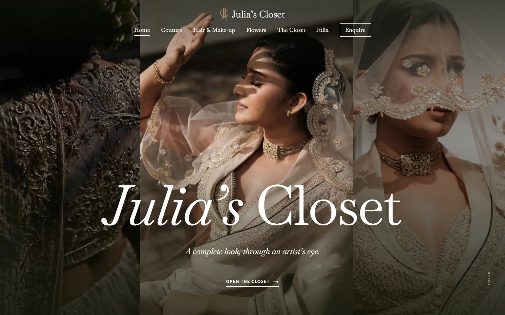
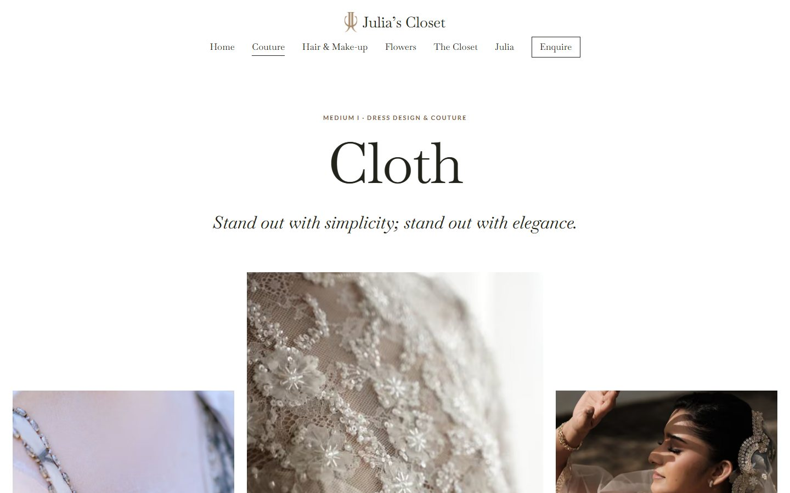
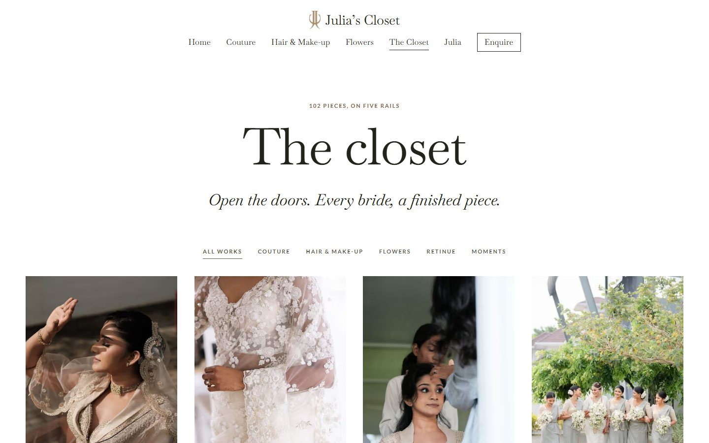
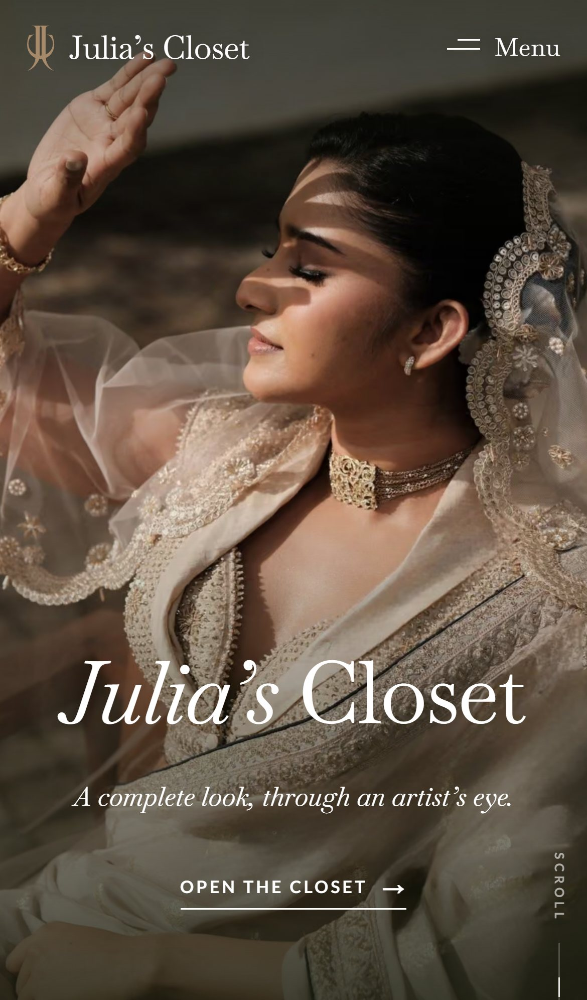

# Julia's Closet

**Website for a bridal atelier in Negombo, Sri Lanka**

Bridal couture · hair and make-up · fresh flower bouquets

**[Visit the live site](https://julias-closet.vercel.app)**

> [!NOTE]
> This is a **showcase repository**: it presents the project, not its source code. The code is private.
> Julia's Closet was designed and built by **Tehan Athaudage** ([Website by TA](https://websitebyta.vercel.app)).

| | |
|---|---|
| **Type** | Client website |
| **My role** | Design and development |
| **Built by** | Tehan Athaudage (Tehan Gimsara), Website by TA |
| **Live** | https://julias-closet.vercel.app |

## About the project

Julia's Closet is the bridal atelier of Julia Siriwardena in Negombo, offering couture, bridal hair and make-up and bouquets as one complete look. The site had to feel like the work itself: quiet, editorial and led by photography, while making it easy for a bride to send an enquiry from her phone.

## What I built

| | |
|---|---|
| **Editorial home page** | Full-bleed bridal photography with a magazine-style layout instead of a template grid. |
| **Three mediums** | Separate pages for couture, hair and make-up, and flowers, each with its own story and gallery. |
| **The Closet** | A filterable portfolio of finished bridal looks. |
| **WhatsApp enquiries** | The enquiry form writes out the bride's details and sends them straight to Julia on WhatsApp. |
| **Local SEO** | LocalBusiness structured data, sitemap, robots rules and per-page metadata for Negombo searches. |
| **Mobile first** | Designed for phones first, where most brides find the site. |

## Screens

<table>
<tr>
<td width="50%"> <b>Couture</b></td>
<td width="50%"> <b>The Closet: portfolio</b></td>
</tr>
<tr>
<td width="50%"> <b>Home page on a phone</b></td>
</tr>
</table>

## Tech stack

Next.js (App Router) · React · TypeScript · CSS · next/font · next/image · Vercel

## Want something like this?

I'm Tehan Athaudage, a freelance web designer and developer from Sri Lanka working with businesses worldwide.

[Portfolio](https://websitebyta.vercel.app) · [LinkedIn](https://www.linkedin.com/in/tehan-athaudage-663102382/) · [Instagram](https://www.instagram.com/websitebyta/) · [Facebook](https://www.facebook.com/Thalric1) · [Email](mailto:websitebyta@gmail.com) · [WhatsApp](https://wa.me/94761629355)

---

© 2026 Tehan Athaudage. Showcase only: see [NOTICE.md](NOTICE.md). Client names, logos and photos belong to their owners.
